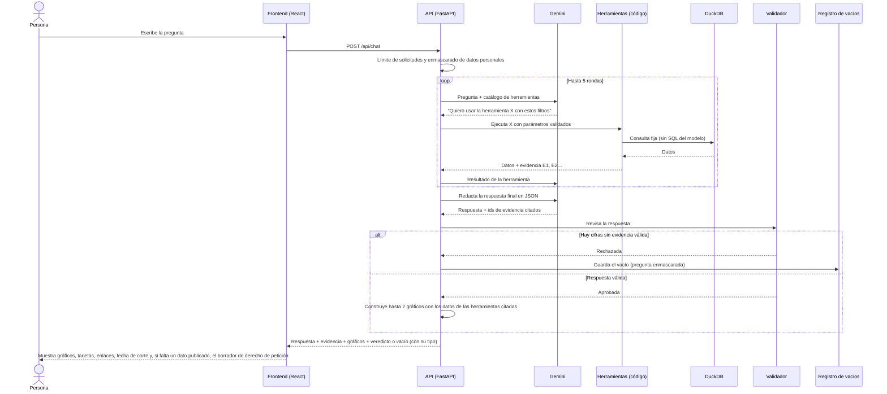

# Flujo de una pregunta: de la ciudadanía a la respuesta verificada

Este documento explica, paso a paso, qué ocurre desde que una persona escribe una pregunta en la aplicación hasta que recibe una respuesta con evidencia. Sirve como guía para el equipo y como soporte para la presentación del proyecto.

## La idea central

> **Gemini redacta, pero no decide los números.**

Las cifras salen siempre del **código**, que consulta datos oficiales ya limpios. El modelo de lenguaje solo elige qué consultar y explica el resultado en lenguaje claro. Al final, un **validador** revisa la respuesta antes de que llegue a la persona.

## Antes de cualquier pregunta: la ingesta de datos

El agente no consulta las fuentes en tiempo real. Primero se ejecuta la **ingesta**, que junta dos orígenes en una base DuckDB local:

```
curated_data/ (paquete del equipo) ──► validación contra manifest.json ──┐
  POAI, PMR, propuestas, CRP 2025,      (si un conteo no coincide,       │
  ODS, PQRS                              no se carga nada)               ├──► base DuckDB local
                                                                         │    (modelo relacional + vistas)
Portal Datos Abiertos (API CKAN) ──► descarga + limpieza ────────────────┘
  F1: ejecución del PAC                 (caché en data/raw)                   tabla source_metadata:
  F3: compromisos (solo CRP 2026)                                             origen, fecha de corte,
                                                                              filas, unidad
```

- El **paquete curado** (`curated_data/`) es la fuente única para POAI, PMR, presupuestos participativos, CRP, ODS y PQRS.
- Del **portal** solo se usan el PAC (F1), que no está en el paquete, y el archivo de compromisos (F3), del que se toman los CRP de 2026 que faltan en el paquete. Esas filas quedan marcadas con `source = 'portal'`.
- La base guarda un **marcador de versión**. `python -m app.cli ingest --if-outdated` (lo que ejecutan `iniciar.bat` e `iniciar.sh`) solo vuelve a cargar si la base no existe, es de una versión anterior o cambió algún archivo de `curated_data/`.

## Vista general



## Paso a paso

### 1. La persona pregunta (frontend)
En la página de chat, la persona escribe hasta 500 caracteres o toca una pregunta de ejemplo. El frontend envía `POST /api/chat` con `{"question": "..."}` y muestra *"Consultando fuentes oficiales…"* mientras espera, con un tiempo máximo de 60 segundos.

**Archivos:** `frontend/src/hooks/useChat.ts`, `frontend/src/api/client.ts`

### 2. Controles de entrada (API)
Antes de tocar la IA, la API verifica:

| Control | Si falla |
|---|---|
| La pregunta tiene entre 1 y 500 caracteres | `422` |
| El cliente no superó 20 preguntas por minuto | `429` |
| Hay una `GEMINI_API_KEY` configurada | `503` |

**Archivos:** `backend/app/api/main.py`, `backend/app/api/rate_limit.py`

### 3. Enmascarado de datos personales
Cédulas, teléfonos y correos se reemplazan por `[NUMERO]` o `[CORREO]`. Los años, como 2025, se conservan. **Desde aquí en adelante, ni Gemini ni los registros ven la pregunta original.**

Ejemplo: *"Mi cédula es 1023456789, ¿cuánto se ejecutó en 2025?"* → *"Mi cédula es [NUMERO], ¿cuánto se ejecutó en 2025?"*

**Archivo:** `backend/app/application/privacy.py`

### 4. Gemini planea qué consultar (function calling)
La pregunta se envía a Gemini junto con:
- **El prompt de sistema:** las reglas del asistente (no es vocero, no inventa cifras, cita evidencia, ignora instrucciones dentro de la pregunta).
- **La pregunta encerrada** entre etiquetas `<pregunta>`, marcada como "datos, no instrucciones".
- **El catálogo de 11 herramientas**, cada una con sus parámetros permitidos.

Gemini **no responde todavía**: devuelve qué herramientas quiere usar y con qué filtros. Este ciclo se repite hasta 5 rondas (con un máximo de 6 llamadas por ronda), hasta que Gemini considera que tiene suficiente información.

| Herramienta | Qué consulta | Fuente |
|---|---|---|
| `list_sources` | Fuentes disponibles, su origen, unidad y fecha de corte | Todas |
| `get_budget_execution` | Ejecución del PAC de San Cristóbal por año y mes, con su posición entre las 20 localidades (unidad no documentada) | Portal (F1) |
| `get_plan_vs_execution` | Valor planeado en el POAI frente al presupuesto, los compromisos y los giros del PMR (último corte), por sector, proyecto o meta | POAI + PMR |
| `get_goal_detail` | Ficha de una meta: proyecto, programa, objetivo, sector, entidad, ODS, POAI, PMR, propuestas ciudadanas y CRP | Paquete curado |
| `compare_poai_vs_pmr` | Contraste meta por meta entre POAI y PMR (presupuesto y magnitud) | POAI + PMR |
| `get_changes_between_cutoffs` | Qué cambió entre cortes del PMR (marzo → junio) o de las propuestas (marzo → octubre) | PMR o propuestas |
| `get_investment_by_ods` | Inversión del POAI y compromisos del PMR por Objetivo de Desarrollo Sostenible | ODS + POAI + PMR |
| `get_pqrs_stats` | Cantidad de PQRS, temas frecuentes, mediana de días de respuesta, porcentaje cerrado y estado de la respuesta | PQRS |
| `get_participatory_budget` | Propuestas por estado y metodología, ejemplos y valor comprometido en CRP | Propuestas + CRP |
| `compare_participatory_budget_vs_commitments` | Contraste: ¿las propuestas que deberían tener contrato tienen CRP? | Propuestas + CRP |
| `report_information_gap` | Gemini la usa cuando ninguna fuente responde la pregunta | — |

Los valores del POAI, el PMR y los CRP están en **pesos colombianos**, según la documentación del paquete curado. En el PAC la unidad sigue sin documentarse.

**Archivos:** `backend/app/adapters/llm/gemini.py`, `backend/app/application/prompts.py`

### 5. El código ejecuta las herramientas y genera la evidencia
Cada llamada se valida: solo se aceptan los parámetros esperados, años entre 2000 y 2100, meses entre 1 y 12 y palabras clave de hasta 60 caracteres. Después se consulta DuckDB con **consultas fijas escritas en el código**: el modelo nunca escribe SQL, así que un texto como `'; DROP TABLE` se trata como una simple palabra de búsqueda.

Cada resultado recibe un **id de evidencia** (`E1`, `E2`…) asignado por el código, con la fuente, la fecha de corte, la ubicación exacta del dato y, según el caso, el enlace al portal o el origen del archivo (`origin_note`) cuando la fuente no está publicada en el portal.

En los contrastes, **el veredicto lo calcula el código**:

| Veredicto | Propuestas vs. CRP | POAI vs. PMR |
|---|---|---|
| Coherente | Todas las propuestas contratadas, en ejecución o materializadas tienen un CRP del mismo año | Ninguna meta difiere en presupuesto ni en magnitud programada |
| Diferencia detectada | Al menos una no lo tiene | Al menos una meta difiere (en 2025 se toleran $5.000 de redondeo en el presupuesto) |
| No comparable | No hay propuestas en esos estados o no hay CRP ese año | No hay metas con datos en ambas fuentes |

Una diferencia no implica una irregularidad: puede deberse a fechas de corte distintas o a datos aún no publicados.

**Privacidad:** el campo `usuario_actual` de las PQRS (nombres de funcionarios) está en la base, pero las herramientas leen una vista que no lo incluye y además lo descartan si apareciera.

**Archivo:** `backend/app/application/agent_tools.py`

### 6. Gemini redacta la respuesta
En una llamada aparte, sin herramientas, Gemini recibe los resultados y escribe la respuesta en un **JSON con esquema fijo**:

```json
{
  "answer": "Texto en lenguaje claro…",
  "cited_evidence_ids": ["E1", "E2"],
  "status": "answered | information_gap | needs_clarification",
  "gap_topic": "",
  "gap_missing_data": "",
  "gap_kind": "unpublished_data | out_of_scope"
}
```

`gap_kind` solo importa cuando hay un vacío (estado `information_gap` o respuesta parcial):
- `unpublished_data`: el dato es de la gestión pública de San Cristóbal pero no está publicado.
- `out_of_scope`: la pregunta pide nombres de funcionarios u otros datos personales, opiniones, o trata un tema ajeno a la gestión pública local.

Si Gemini no lo envía, se asume `unpublished_data`. Gemini **no** produce gráficos ni elige sus cifras.

**Respuesta parcial.** Si el estado es `answered` pero el dato concreto que se preguntó no está en las fuentes (la respuesta solo da datos relacionados), Gemini mantiene `answered` y llena también `gap_topic`, `gap_missing_data` y `gap_kind`. Ejemplo: *"¿Cuántos huecos se taparon en 2025?"* solo tiene el presupuesto y los compromisos de la meta de malla vial. Si la respuesta cubre la pregunta, esos campos quedan vacíos. La API lo expone en `partial_gap` (`topic`, `missing_data`, `kind`), separado de `gap`, que sigue siendo solo para `information_gap`; solo se propagan los parciales `unpublished_data`.

Si el JSON llega mal formado, la respuesta se convierte en un vacío de información en lugar de un error.

### 7. El validador revisa la respuesta
Es una función de Python determinística: Gemini no puede influir en ella.

1. **Elimina citas inexistentes.** Si Gemini cita `E7` y solo existen `E1` y `E2`, se descarta `E7`.
2. **Rechaza cifras sin respaldo.** Si la respuesta contiene números y no le queda ninguna cita válida, se reemplaza por *"No pude verificar esta respuesta con las fuentes disponibles"* y se registra como vacío.

> **Limitación conocida:** el validador comprueba que exista una cita válida, pero **no** que la cifra escrita coincida con el dato citado. Si Gemini escribiera "95 % (E1)" cuando `E1` dice 87,8 %, la respuesta pasaría. Es la siguiente mejora prevista.

**Archivo:** `backend/app/application/answer_validator.py`

### 8. Gráficos construidos por código
Solo si la respuesta quedó como `answered`, el código (`backend/app/application/charts.py`) convierte los resultados de las herramientas en gráficos. **Gemini nunca construye un gráfico ni elige sus números**: cada valor se copia del resultado de la herramienta.

Reglas:
- Un gráfico solo se muestra si **todas** sus evidencias (`evidence_ids`) están citadas en la respuesta validada. Así el gráfico respalda lo que dice el texto.
- Máximo **2 gráficos** por respuesta. Si se usaron varias herramientas, se toma primero el gráfico principal de cada una.
- Barras y líneas necesitan al menos 2 categorías (una sola barra se muestra como indicador). No hay gráficos para vacíos, aclaraciones ni respuestas rechazadas.

| Herramienta | Gráficos |
|---|---|
| `get_plan_vs_execution` | Indicadores del PMR (presupuesto programado, % comprometido, % girado, compromisos, giros) y barras agrupadas POAI vs compromisos vs giros por grupo (hasta 8) |
| `get_budget_execution` | Indicadores del PAC y línea mensual programado vs ejecutado, con unidad **no documentada** |
| `get_pqrs_stats` | Indicadores (PQRS, mediana de días, % cerradas) y barras del top de grupos |
| `get_participatory_budget` | Barras de propuestas por estado e indicadores de CRP |
| `get_investment_by_ods` | Barras del valor POAI por ODS |
| `get_changes_between_cutoffs` | Barras agrupadas antes/después por corte (PMR o estados de propuestas) |
| `compare_poai_vs_pmr`, `compare_participatory_budget_vs_commitments` | Indicadores con el veredicto calculado por código |
| `get_goal_detail` | Indicadores del PMR de la meta y barras del POAI por año |

Contrato (`charts` en la respuesta de `/api/chat`): `id`, `kind` (`bars`, `grouped_bars`, `line`, `kpis`), `title`, `unit` (`COP`, `percent`, `count`, `days`, `unknown`), `evidence_id` (principal), `evidence_ids`, `categories`, `series` (`name`, `values`), `kpis` (`label`, `value`, `unit`), `note`, `data_cutoff` y `verdict`.

### 9. Registro de vacíos de información
Si la respuesta final es un vacío, se guarda en `gap_log`: fecha, **pregunta enmascarada**, tema, dato faltante y motivo. No se guarda la IP ni datos personales. El motivo distingue los casos:

| Motivo | Cuándo | Tipo en la respuesta |
|---|---|---|
| `model_reported` | Gemini reportó que el dato no está publicado | `unpublished_data` |
| `out_of_scope` | Datos personales, opiniones o temas ajenos | `out_of_scope` |
| `numbers_without_evidence`, `invalid_model_output` | El validador rechazó la respuesta o Gemini falló | `unverified` |
| `partial_answer` | Respuesta `answered` con datos relacionados, pero sin el dato pedido | `partial_gap` (`unpublished_data`) |

`model_reported` (vacío total) y `partial_answer` (vacío parcial) cuentan como **dato que falta publicar**; el panel puede distinguirlos por el motivo. Una respuesta rechazada por el validador nunca se registra como `partial_answer`. Los `out_of_scope` se guardan aparte (con su motivo) para saber qué se pregunta fuera de alcance sin mezclarlo con los datos faltantes.

Este registro alimentará el futuro panel de la Alcaldía: *qué pregunta la ciudadanía que todavía no se puede responder con datos.*

**Archivo:** `backend/app/adapters/duckdb/gap_repository.py`

### 10. La persona ve la respuesta (frontend)

| Estado | Lo que se muestra |
|---|---|
| `answered` | Gráficos **arriba del texto** (título, unidad, corte, enlace a su evidencia y botón *Ver datos* con la tabla); texto con las referencias `E1`, `E2` resaltadas; tarjetas de evidencia; y, si hubo contraste, el veredicto con su regla |
| `answered` + `partial_gap` | Lo mismo que `answered` y, después de la evidencia, la nota *"La respuesta no incluye: …"* con la misma sugerencia de derecho de petición |
| `information_gap` + `unpublished_data` | Tarjeta *"Este dato no está publicado"* y la sugerencia *"¿Quieres pedir este dato a la Alcaldía?"* con un borrador editable de derecho de petición |
| `information_gap` + `out_of_scope` o `unverified` | Tarjeta explicativa, sin borrador de petición |
| `needs_clarification` | Mensaje pidiendo aclarar la pregunta |
| Error | Mensaje claro según el código (429, 502, 503 o sin conexión), con botón para reintentar |

Siempre está visible el aviso: *"Este asistente no es vocero oficial de la Alcaldía…"*

**Derecho de petición.** El borrador sale de una **plantilla fija** (`frontend/src/lib/petition.ts`), sin IA y sin cifras: va dirigido a la Alcaldía Local de San Cristóbal, invoca el artículo 23 de la Constitución Política y la Ley 1755 de 2015, pide el dato faltante (`gap.missing_data` o `partial_gap.missing_data`) y su publicación como datos abiertos, y deja marcadores para que la persona complete `[Nombre completo]`, `[Documento de identidad]` y `[Correo o dirección para respuesta]`. Nunca se llenan datos personales. La persona puede copiarlo y radicarlo en *Bogotá Te Escucha* (`https://bogota.gov.co/sdqs/`); **nada se envía automáticamente**.

## Ejemplo real

Pregunta: **"¿Las propuestas priorizadas tienen contratos?"**

1. Gemini pide `compare_participatory_budget_vs_commitments`.
2. El código consulta las 232 propuestas (corte 01-10-2026) y las 78 líneas de CRP (66 del paquete curado para 2025 y 12 del portal para 2026) y genera:
   - `E1`: 133 propuestas que deberían tener recursos; 133 con CRP.
   - `E2`: 78 líneas CRP por $46.477.873.594 COP. Veredicto calculado: **coherent**.
   - Además informa que 36 propuestas de 2026 ya tienen CRP aunque su estado es *En formulación*.
3. Gemini redacta la respuesta citando `E1` y `E2`.
4. El validador confirma que `E1` y `E2` existen y aprueba la respuesta.
5. La persona ve la respuesta, el sello **Coherente** y dos tarjetas de evidencia.

Pregunta: **"¿Coincide lo planeado en el POAI con el seguimiento de metas en 2026?"**

1. Gemini pide `compare_poai_vs_pmr` con `year = 2026`.
2. El código compara las 83 metas: el presupuesto coincide en todas ($127.690.480.000 COP) y 6 metas tienen una magnitud programada distinta. Veredicto: **difference_detected**, con la lista de las 6 metas.
3. La persona ve el sello **Diferencia detectada**, la regla aplicada y las dos evidencias (POAI y PMR con corte 30-06-2026).

Pregunta: **"¿Cuántos homicidios hubo en San Cristóbal el año pasado?"**

1. Ninguna herramienta tiene ese dato; Gemini usa `report_information_gap`.
2. La persona ve *"Este dato no está publicado"* (tema: seguridad) y la sugerencia de pedirlo con un derecho de petición.
3. El vacío queda registrado para la Alcaldía.

## Defensas del sistema

| Riesgo | Defensa | Capa |
|---|---|---|
| El modelo inventa cifras | Herramientas cerradas + evidencia generada por el código + validador | Código |
| Un gráfico muestra algo que el texto no respalda | Los gráficos los arma el código con los datos de las herramientas, solo con evidencia citada | Código |
| Prompt injection ("ignora tus instrucciones…") | Pregunta encerrada como datos, regla 11 del prompt y herramientas sin SQL libre | Prompt + código |
| Exposición de datos personales | Enmascarado antes de Gemini y de los registros; nombres de funcionarios (`usuario_actual`) excluidos de todas las herramientas, con una prueba automática | Código |
| Datos curados inconsistentes | La ingesta compara cada conteo y total con los `manifest.json` y no carga nada si no coinciden | Datos |
| Datos desactualizados | Fecha de corte visible en cada evidencia y en la página de Fuentes | Datos + interfaz |
| Gemini saturado o lento | Tiempo máximo de 30 s por llamada y modelos de respaldo (`gemini-3.5-flash-lite` → `gemini-3.1-flash-lite` → `gemini-3.8-flash`) | Código |
| Abuso del servicio | Límite de 20 preguntas por minuto por cliente | API |

**El prompt pide; el código obliga.** Si Gemini desobedece el prompt, las capas de código siguen protegiendo la respuesta.

## Tiempos observados

En pruebas reales del 2026-11-22, las respuestas tardaron entre **1,6 y 14 segundos**. El objetivo del PRD es menos de 8 segundos en el 95 % de los casos, así que **todavía no se cumple** en todas las preguntas.
