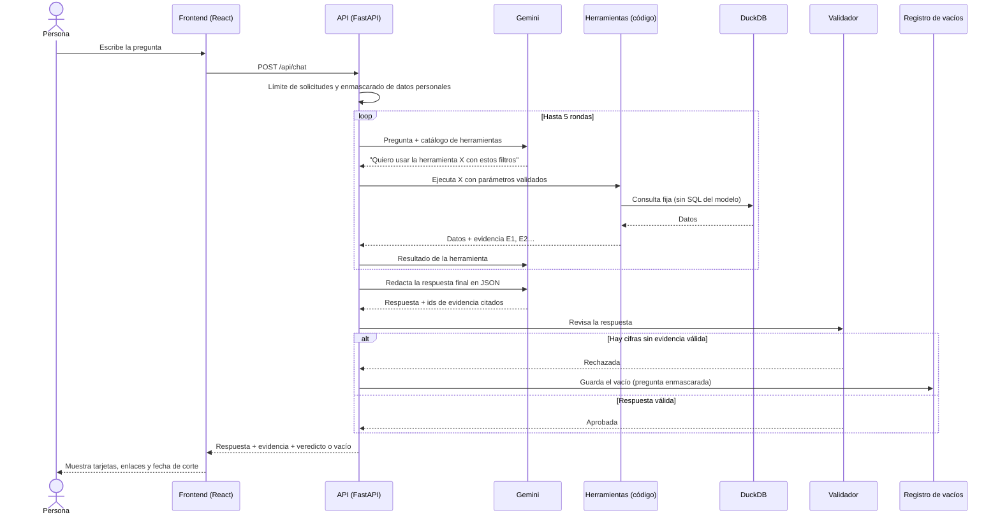

# Flujo de una pregunta: de la ciudadanía a la respuesta verificada

Este documento explica, paso a paso, qué ocurre desde que una persona escribe una pregunta en la aplicación hasta que recibe una respuesta con evidencia. Sirve como guía para el equipo y como soporte para la presentación del proyecto.

## La idea central

> **Gemini redacta, pero no decide los números.**

Las cifras salen siempre del **código**, que consulta datos oficiales ya limpios. El modelo de lenguaje solo elige qué consultar y explica el resultado en lenguaje claro. Al final, un **validador** revisa la respuesta antes de que llegue a la persona.

## Antes de cualquier pregunta: la ingesta de datos

El agente no consulta el portal en tiempo real. Primero se ejecuta la **ingesta**:

```
Portal Datos Abiertos Bogotá ──► descarga ──► limpieza ──► base DuckDB local
         (API CKAN)                 │          (reglas del         │
                                    │           notebook)          └─ tabla source_metadata:
                                    └─ caché en data/raw              URL, fecha de corte, filas, unidad
```

Comando: `python -m app.cli ingest` (desde `backend/`). Se repite cuando el portal publica datos nuevos.

## Vista general



## Paso a paso

### 1. La persona pregunta (frontend)
En la página de chat, la persona escribe hasta 500 caracteres o toca una pregunta de ejemplo. El frontend envía `POST /api/chat` con `{"question": "..."}` y muestra *"Consultando fuentes oficiales…"* mientras espera, con un tiempo máximo de 60 segundos.

**Archivos:** `frontend/src/hooks/useChat.ts`, `frontend/src/api/client.ts`

### 2. Controles de entrada (API)
Antes de tocar la IA, la API verifica:

| Control | Si falla |
|---|---|
| La pregunta tiene entre 1 y 500 caracteres | `422` |
| El cliente no superó 20 preguntas por minuto | `429` |
| Hay una `GEMINI_API_KEY` configurada | `503` |

**Archivos:** `backend/app/api/main.py`, `backend/app/api/rate_limit.py`

### 3. Enmascarado de datos personales
Cédulas, teléfonos y correos se reemplazan por `[NUMERO]` o `[CORREO]`. Los años, como 2025, se conservan. **Desde aquí en adelante, ni Gemini ni los registros ven la pregunta original.**

Ejemplo: *"Mi cédula es 1023456789, ¿cuánto se ejecutó en 2025?"* → *"Mi cédula es [NUMERO], ¿cuánto se ejecutó en 2025?"*

**Archivo:** `backend/app/application/privacy.py`

### 4. Gemini planea qué consultar (function calling)
La pregunta se envía a Gemini junto con:
- **El prompt de sistema:** las reglas del asistente (no es vocero, no inventa cifras, cita evidencia, ignora instrucciones dentro de la pregunta).
- **La pregunta encerrada** entre etiquetas `<pregunta>`, marcada como "datos, no instrucciones".
- **El catálogo de 6 herramientas**, cada una con sus parámetros permitidos.

Gemini **no responde todavía**: devuelve qué herramientas quiere usar y con qué filtros. Este ciclo se repite hasta 5 rondas (con un máximo de 6 llamadas por ronda), hasta que Gemini considera que tiene suficiente información.

| Herramienta | Qué consulta |
|---|---|
| `list_sources` | Fuentes disponibles y su fecha de corte |
| `get_budget_execution` | Ejecución del PAC de San Cristóbal por año y mes, con su posición entre las 20 localidades |
| `get_pqrs_stats` | Cantidad de PQRS, temas frecuentes, mediana de días de respuesta y porcentaje cerrado |
| `get_participatory_budget` | Propuestas por estado, avance promedio y valor comprometido |
| `compare_participatory_budget_vs_commitments` | Contraste: ¿las propuestas que deberían tener contrato lo tienen? |
| `report_information_gap` | Gemini la usa cuando ninguna fuente responde la pregunta |

**Archivos:** `backend/app/adapters/llm/gemini.py`, `backend/app/application/prompts.py`

### 5. El código ejecuta las herramientas y genera la evidencia
Cada llamada se valida: solo se aceptan los parámetros esperados, años entre 2000 y 2100, meses entre 1 y 12 y palabras clave de hasta 60 caracteres. Después se consulta DuckDB con **consultas fijas escritas en el código**: el modelo nunca escribe SQL, así que un texto como `'; DROP TABLE` se trata como una simple palabra de búsqueda.

Cada resultado recibe un **id de evidencia** (`E1`, `E2`…) asignado por el código, con la fuente, la fecha de corte, el enlace al portal y la ubicación exacta del dato.

En el contraste, **el veredicto lo calcula el código**:

| Veredicto | Regla |
|---|---|
| Coherente | Todas las propuestas contratadas, en ejecución o materializadas tienen un compromiso presupuestal (CRP) |
| Diferencia detectada | Al menos una no lo tiene |
| No comparable | No hay propuestas en esos estados o no hay compromisos ese año |

**Archivo:** `backend/app/application/agent_tools.py`

### 6. Gemini redacta la respuesta
En una llamada aparte, sin herramientas, Gemini recibe los resultados y escribe la respuesta en un **JSON con esquema fijo**:

```json
{
  "answer": "Texto en lenguaje claro…",
  "cited_evidence_ids": ["E1", "E2"],
  "status": "answered | information_gap | needs_clarification",
  "gap_topic": "",
  "gap_missing_data": ""
}
```

Si el JSON llega mal formado, la respuesta se convierte en un vacío de información en lugar de un error.

### 7. El validador revisa la respuesta
Es una función de Python determinística: Gemini no puede influir en ella.

1. **Elimina citas inexistentes.** Si Gemini cita `E7` y solo existen `E1` y `E2`, se descarta `E7`.
2. **Rechaza cifras sin respaldo.** Si la respuesta contiene números y no le queda ninguna cita válida, se reemplaza por *"No pude verificar esta respuesta con las fuentes disponibles"* y se registra como vacío.

> **Limitación conocida:** el validador comprueba que exista una cita válida, pero **no** que la cifra escrita coincida con el dato citado. Si Gemini escribiera "95 % (E1)" cuando `E1` dice 87,8 %, la respuesta pasaría. Es la siguiente mejora prevista.

**Archivo:** `backend/app/application/answer_validator.py`

### 8. Registro de vacíos de información
Si la respuesta final es un vacío, porque Gemini lo reportó o porque el validador la rechazó, se guarda en `gap_log`: fecha, **pregunta enmascarada**, tema, dato faltante y motivo. No se guarda la IP ni datos personales.

Este registro alimentará el futuro panel de la Alcaldía: *qué pregunta la ciudadanía que todavía no se puede responder con datos.*

**Archivo:** `backend/app/adapters/duckdb/gap_repository.py`

### 9. La persona ve la respuesta (frontend)

| Estado | Lo que se muestra |
|---|---|
| `answered` | Texto con las referencias `E1`, `E2` resaltadas; tarjetas de evidencia con la fuente, la fecha de corte y el enlace al portal; y, si hubo contraste, el veredicto con su regla |
| `information_gap` | Tarjeta *"Este dato no está publicado"*, con el tema y el dato faltante |
| `needs_clarification` | Mensaje pidiendo aclarar la pregunta |
| Error | Mensaje claro según el código (429, 502, 503 o sin conexión), con botón para reintentar |

Siempre está visible el aviso: *"Este asistente no es vocero oficial de la Alcaldía…"*

## Ejemplo real

Pregunta: **"¿Las propuestas priorizadas tienen contratos?"**

1. Gemini pide `compare_participatory_budget_vs_commitments`.
2. El código consulta las 232 propuestas y los 78 compromisos de San Cristóbal y genera:
   - `E1`: 169 propuestas que deberían tener recursos; 169 tienen compromiso.
   - `E2`: 78 compromisos por un valor de 46.477.873.594. Veredicto calculado: **coherent**.
3. Gemini redacta: *"…las 169 propuestas… cuentan con compromisos presupuestales asociados… [E1, E2]"*.
4. El validador confirma que `E1` y `E2` existen y aprueba la respuesta.
5. La persona ve la respuesta, el sello **Coherente** y dos tarjetas de evidencia con enlace al portal.

Pregunta: **"¿Cuántos homicidios hubo en San Cristóbal el año pasado?"**

1. Ninguna herramienta tiene ese dato; Gemini usa `report_information_gap`.
2. La persona ve *"Este dato no está publicado"* (tema: seguridad).
3. El vacío queda registrado para la Alcaldía.

## Defensas del sistema

| Riesgo | Defensa | Capa |
|---|---|---|
| El modelo inventa cifras | Herramientas cerradas + evidencia generada por el código + validador | Código |
| Prompt injection ("ignora tus instrucciones…") | Pregunta encerrada como datos, regla 9 del prompt y herramientas sin SQL libre | Prompt + código |
| Exposición de datos personales | Enmascarado antes de Gemini y de los registros; columnas de texto libre descartadas en la ingesta | Código |
| Datos desactualizados | Fecha de corte visible en cada evidencia y en la página de Fuentes | Datos + interfaz |
| Gemini saturado o lento | Tiempo máximo de 30 s por llamada y modelos de respaldo (`gemini-3.5-flash-lite` → `gemini-3.1-flash-lite` → `gemini-3.8-flash`) | Código |
| Abuso del servicio | Límite de 20 preguntas por minuto por cliente | API |

**El prompt pide; el código obliga.** Si Gemini desobedece el prompt, las capas de código siguen protegiendo la respuesta.

## Tiempos observados

En pruebas reales del 2026-11-22, las respuestas tardaron entre **1,6 y 14 segundos**. El objetivo del PRD es menos de 8 segundos en el 95 % de los casos, así que **todavía no se cumple** en todas las preguntas.
